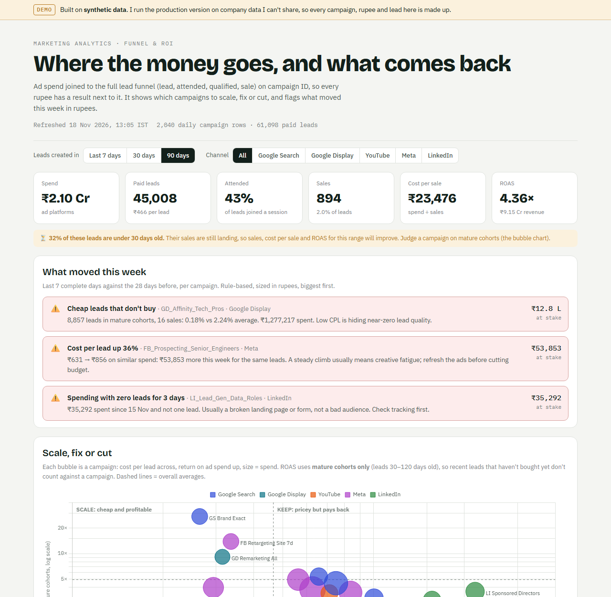
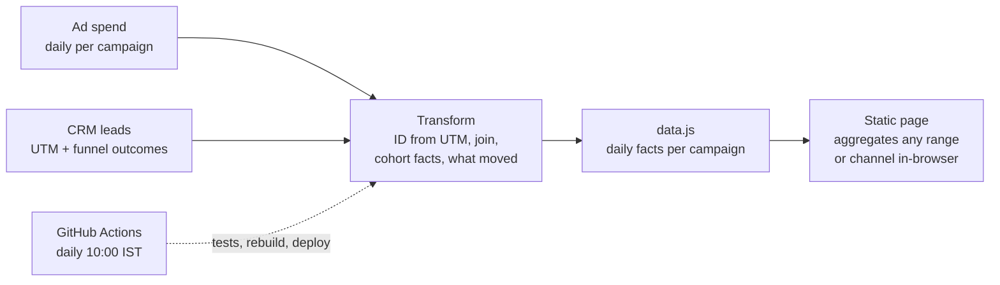
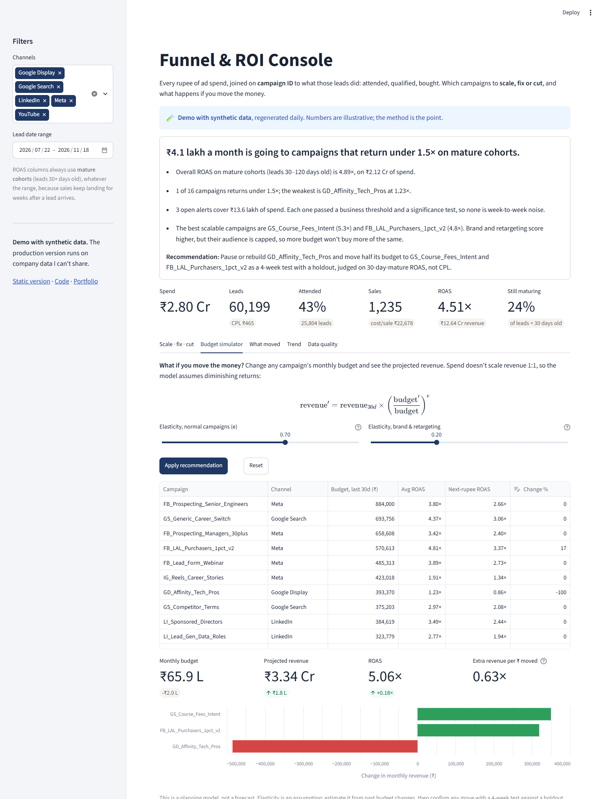

<div align="center">

# Funnel &amp; ROI Console

**Where the money goes, and what comes back: ad spend joined to the full lead funnel on campaign ID, with scale / fix / cut and "what moved this week" in rupees.**

[](https://nikhilveerwani.github.io/funnel-roi-console/)
[](https://nikhil-funnel-roi.streamlit.app)
[](https://github.com/nikhilveerwani/funnel-roi-console/actions/workflows/refresh.yml)


<a href="https://nikhilveerwani.github.io/funnel-roi-console/"></a>

</div>

> **Demo with synthetic data.** I built and run the production version of this console on company data I can't share. This repo is a clean-room rebuild: fresh code, a made-up business with 16 campaigns across Google, Meta, YouTube and LinkedIn, and the same rules.

## Executive summary

- **The cheapest campaign is the worst investment.** About ₹145 per lead, but about 0.2% of its leads buy, against 2.2% on average (95% interval 0.11–0.29%). Ranked by CPL, it gets more budget.
- **About ₹4 lakh a month goes to campaigns returning under 1.5×** on mature cohorts. Overall mature ROAS is about 4.9×.
- **A name-based spend join loses about 13% of paid leads.** The ID join recovers them.
- **Recommendation:** pause the weakest campaign, test half its budget on the two best *scalable* campaigns for 4 weeks with a holdout, and judge on 30-day-mature ROAS. Full reasoning in the **[decision memo](docs/decision_memo.md)**.

*The live page recomputes this summary from each morning's data.*

## The problem

Marketing reports cost per lead. Sales reports revenue. Nobody can say which campaign's rupees turned into which sales, so budget follows the cheapest leads rather than the most profitable ones.

Joining the two sounds easy. In practice it breaks in three quiet ways:

1. **The join key.** The obvious join is campaign *name*. But campaigns get renamed in the ad platform, while links already out in the world keep the old name in the UTM. UTMs also arrive lower-cased, with stray spaces, or URL-encoded. In this demo a name join loses **about 13% of paid leads**. The numeric campaign ID never changes, and matches **about 98.5%**.
2. **Timing.** Sales land days or weeks after the lead (here, only about 40% within a week, 99% within a month). Judge last week's campaigns on sales so far and every new campaign looks like a failure.
3. **Cheap ≠ good.** The lowest cost-per-lead campaign can be the worst investment if those leads never buy.

## What the console shows

| View | Decision it supports |
|---|---|
| **KPIs** with a maturity note | Spend, leads, CPL, sales, cost per sale and ROAS for any range or channel, and an honest flag when the range is too recent for final numbers |
| **What moved this week** | Rule-based alerts sized in rupees: spend with zero leads (broken landing page), CPL jumps (creative fatigue), cheap leads that never buy |
| **Scale, fix or cut** | Every campaign by CPL vs ROAS on **mature cohorts only**, sized by spend, against average and break-even lines |
| **Weekly spend and CPL** | Is efficiency drifting? |
| **Funnel by channel** | Attend → qualify → buy rates: where each channel loses people |
| **Every campaign** | A sortable table, with renamed campaigns flagged and the share of each campaign's leads still maturing |
| **Join quality** | Name join vs ID join, and the sale-lag curve behind the 30-day maturity rule |

## The rules (and why)

- **Join on campaign ID**, extracted from the end of the UTM (`name__id`). The extraction tolerates case, spaces and URL-encoding. Names are display-only: the latest name is shown, and old names are kept as a "renamed" hint. Leads without an ID are reported as unmatched, never guessed.
- **Outcomes belong to the lead's creation date**, so spend on a day sits next to what *those* leads did, whenever they bought.
- **A cohort matures for 30 days** before its ROAS is judged. The data supports this: 99% of sales land within 30 days.
- **"What moved" is rules, not a language model.** It compares the last 7 days with the 28 before. It only fires above ₹30k weekly spend, with thresholds of +25% / −20% CPL, zero leads for 3 days, and a sale rate under 15% of average. Every alert carries a rupee figure, so the biggest problem is at the top.

## Statistical checks: why an alert isn't noise

Every alert must clear a business threshold **and** a statistical test, so the list stays short and trustworthy:

| Alert | Test |
|---|---|
| CPL up / down | Leads per rupee compared across the two periods with a conditional binomial (Poisson rate) test. It fires only at p < 0.01, so normal weekly wobble doesn't page anyone (there's a unit test for exactly that) |
| Cheap leads that don't buy | 95% Wilson interval on the mature sale rate. It fires only if even the *upper* end is below 15% of the average |
| Zero leads with spend | Poisson probability of zero leads given what the spend would normally buy (about 23 leads expected → p < 0.001) |

## Limitations, and what I'd do next

- **Last-touch credit** undervalues campaigns that warm people up for another campaign to convert. Next: a position-based or data-driven model compared with this one.
- **ROAS is not incrementality.** Brand and retargeting partly capture people who'd buy anyway. Next: geo or audience holdouts before scaling them.
- **Returns fall as a campaign scales**, which is why the recommendation is a test, not a reallocation.
- **Booked revenue, not net.** Next: join finance's net revenue (refunds, EMI defaults), which can differ by channel.

## How it works



| Path | What it is |
|---|---|
| `pipeline/generate_synthetic.py` | Synthetic spend and leads, with the traps built in: a renamed campaign, messy UTMs, sale lag, and planted stories |
| `pipeline/transform.py` | ID extraction, the join (both ways, to measure the gap), daily cohort facts, sale-lag curve, rule-based callouts |
| `sql/campaign_roi.sql` | The same join and metrics in BigQuery SQL (`REGEXP_EXTRACT` on the UTM, full outer join of spend and funnel, maturity share) |
| `tests/` | 12 tests: ID extraction edge cases, each callout rule (including that small noise does *not* fire), and the statistical helpers |
| `docs/decision_memo.md` | One-page memo for the CEO: the decision, the evidence, the options, the recommendation, and what would change it |
| `docs/data_dictionary.md` | Every input column, output field, metric definition and alert rule |
| `site/index.html` | A single static page (vanilla JS + Chart.js) |

## Interactive version (Streamlit)

**[Open the app →](https://nikhil-funnel-roi.streamlit.app)**

The same data and the same tested rules (it imports `pipeline/transform.py`), plus what a static page can't do:

- **Filters** by channel and lead date.
- **Scale / fix / cut** against the median *scalable* campaign. Brand and retargeting inflate the plain average, which would make every healthy prospecting campaign look "below average".
- **Budget simulator.** Edit any campaign's budget and see projected revenue and ROAS. It assumes diminishing returns, `revenue' = revenue × (budget'/budget)^e`, with the elasticity on a slider and a lower one for capped audiences. "Apply recommendation" cuts the weakest campaign and moves half its budget to the two best scalable ones. On the day I built it, that came to about +₹1.8 L a month in revenue on ₹2 L less spend.
- An `AppTest` smoke test clicks the button and checks that revenue rises while the budget falls.



## Run it locally

```bash
python -m unittest discover -s tests
python pipeline/generate_synthetic.py --out data --days 120
python pipeline/transform.py --data data --out site/data.js
# open site/index.html

pip install -r requirements.txt        # only for the Streamlit app
streamlit run streamlit_app.py
```

The pipeline uses only the Python standard library; the app adds Streamlit, pandas and Altair.

---

<sub>Built by <a href="https://nikhilveerwani.github.io/">Nikhil Veerwani</a> · Analytics, BI &amp; Growth · All data in this repository is synthetic.</sub>
